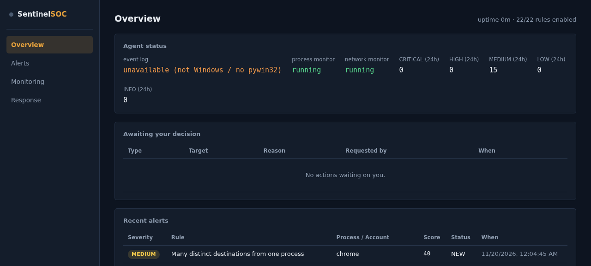
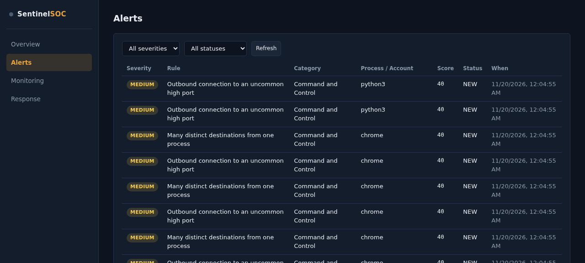
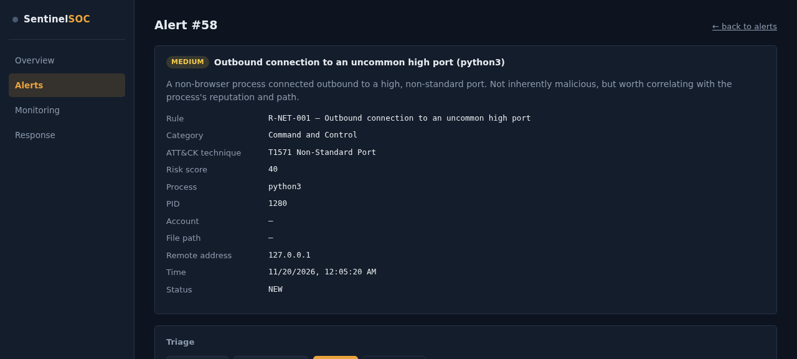
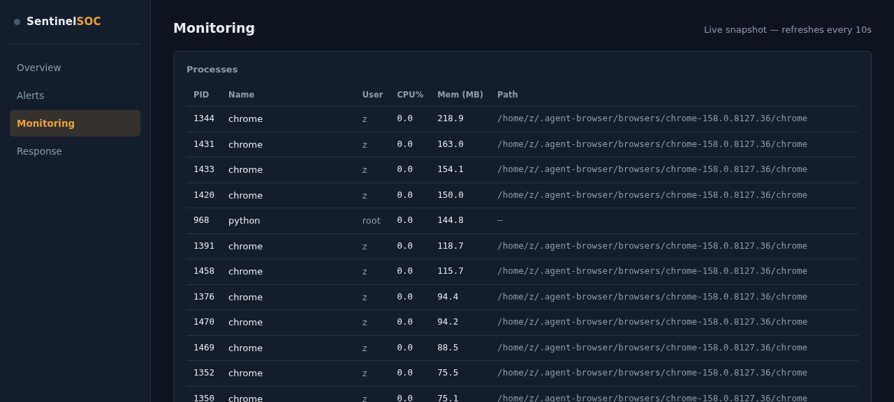
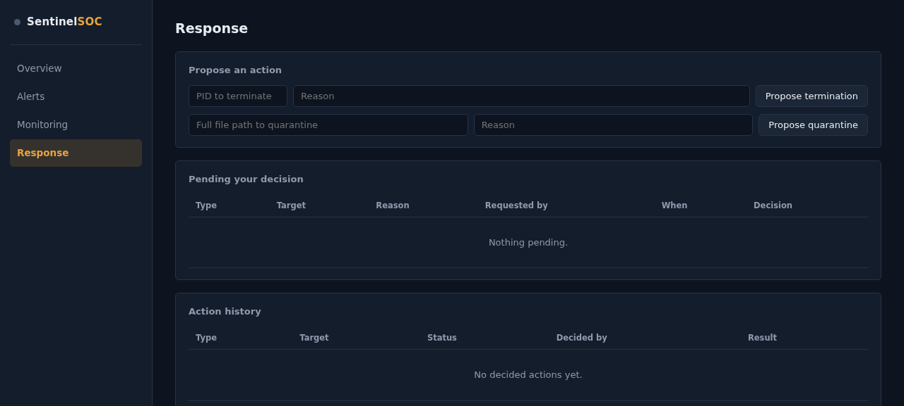

# SentinelSOC


A local Windows SOC agent: it watches a Windows 10/11 machine (Event Log,
processes, network connections), runs that telemetry through an offline
rule-based detection engine, scores risk, correlates related alerts into
incidents, and gives you a local dashboard to investigate and — only with
your explicit approval — terminate a process or quarantine a file.

Everything runs locally. There is no cloud service, no telemetry leaves the
machine, and no response action ever executes without a named analyst
approving it first.



<details>
<summary>More screenshots (alerts, alert detail, monitoring, response)</summary>

| | |
|---|---|
|  |  |
|  |  |

</details>

## What's included

| Deliverable | Where |
|---|---|
| Python source | `sentinelsoc/` package |
| Windows background service | `sentinelsoc/service_win.py` + `scripts/install.ps1` |
| SOC dashboard & alert management | `sentinelsoc/dashboard/`, `sentinelsoc/api/` |
| Windows Event Log collection | `sentinelsoc/collectors/eventlog_collector.py` |
| Process & network monitoring | `sentinelsoc/collectors/process_monitor.py`, `network_monitor.py` |
| Local threat detection & risk scoring | `sentinelsoc/detection/` |
| Incident investigation recommendations | `sentinelsoc/investigate/recommendations.py` |
| Controlled process termination & file quarantine | `sentinelsoc/response/actions.py` |
| Installation / deployment scripts | `scripts/*.ps1` |
| Configuration & technical docs | `config/config.yaml.example`, `docs/DOCUMENTATION.md` |

## Quick start (Windows 10/11)

1. Install [Python 3.10+](https://www.python.org/downloads/windows/) if you
   don't have it — tick **"Add python.exe to PATH"** during setup.
2. Extract this project to wherever you want it to live permanently (e.g.
   `C:\SentinelSOC`) — the installer sets things up *in place*, it doesn't
   copy itself to Program Files.
3. Open PowerShell **as Administrator**, `cd` into that folder, and run:

   ```powershell
   .\scripts\install.ps1
   ```

   This creates a virtual environment, installs dependencies, creates
   `data\`, `logs\`, `quarantine\`, locks down folder permissions, and
   installs + starts the `SentinelSOC` Windows Service.
4. Open **http://127.0.0.1:8765/** in a browser on that machine.
5. Log in with the key the app generated on first run — it's in
   `config\config.yaml` (created automatically from
   `config\config.yaml.example` the first time it starts) under
   `api.api_key`. That file is gitignored on purpose — see
   "Design decisions" below.

Prefer to try it without installing a service first? Run
`.\scripts\run_desktop.ps1` instead — same app, running in the foreground
in your current terminal, `Ctrl+C` to stop.

To manage the service afterwards: `scripts\service_control.ps1 {start|stop|restart|status}`.
To remove it: `scripts\uninstall.ps1`.

## Running the tests

The database layer, detection engine, scoring, incident correlation,
response actions, and the full FastAPI app are covered by a pytest suite
(`tests/`) that runs on every push via GitHub Actions. To run it yourself:

```powershell
.venv\Scripts\python.exe -m pip install -r requirements-dev.txt
.venv\Scripts\python.exe -m pytest -v
```

(or the `python3`/`pytest` equivalents on macOS/Linux, if you're developing
on something other than the Windows target). This doesn't cover the two
Windows-only modules — see "Status and limitations" below.

## How response actions work

The detection engine can only ever **propose** an action — it writes a
`PENDING` row and stops. Nothing is terminated or quarantined until you (or
another analyst) open the **Response** tab and click **Approve**, giving
your name for the audit trail. Rejecting an action leaves the target alone.
Every proposal, approval, rejection, and execution is written to the audit
log (`/api/audit`).

## Design decisions worth knowing about

- **Local/offline only.** Detection is pattern-based against locally
  observed data (process metadata, command lines, event log fields,
  connection tuples) — there's no cloud reputation lookup and no bundled
  threat feed. `config/blocklist_ips.txt` is yours to populate.
- **Dashboard binds to 127.0.0.1 by default** and requires the API key (or
  a session from logging in with it) for every request — including the
  JSON API. Change `api.host` deliberately if you need LAN access, and see
  "Exposing the dashboard beyond localhost" in `docs/DOCUMENTATION.md` first.
- **No changes to other security tools.** The installer does not add
  Windows Defender exclusions or otherwise weaken endpoint protection —
  that's a judgment call left to you, deliberately not automated here.
- **Transparent naming.** The service, process, and dashboard are all named
  `SentinelSOC` everywhere — nothing about this tool hides itself.
- **`config/config.yaml` is gitignored; `config.yaml.example` is the
  template.** The real config gets a freshly generated API key written into
  it on first run (see `Config._ensure_api_key` in `sentinelsoc/config.py`).
  Keeping that file out of version control means your generated key (or
  anyone else's, if they fork/clone this) never accidentally ends up in a
  commit.

## Status and limitations

This is a complete, working reference implementation — the database layer,
detection engine, scoring, incident correlation, response actions, and the
full FastAPI + dashboard were built and integration-tested end-to-end
(auth flow, every API route, every page, a real process termination and
file quarantine through the actual HTTP API). The screenshots above are
from an independent live run (not just the automated tests) — you can see
the event log collector correctly reporting itself as unavailable on that
non-Windows host, and real alerts firing off live network traffic from an
actual browser process. The two pieces that are inherently Windows-only —
`eventlog_collector.py`'s use of `pywin32`'s classic Event Log API, and the
`service_win.py` Windows Service wrapper — are written to well-documented,
standard patterns but **have not yet been exercised on a real Windows
machine**. Validate those two specifically before relying on this in
production; see "Validating on real Windows" in `docs/DOCUMENTATION.md`.

Full details, configuration reference, architecture, and the API are in
[`docs/DOCUMENTATION.md`](docs/DOCUMENTATION.md).

## License

MIT — see [`LICENSE`](LICENSE). Update the copyright line in that file with
your own name/organization before or after pushing; it's a placeholder.
